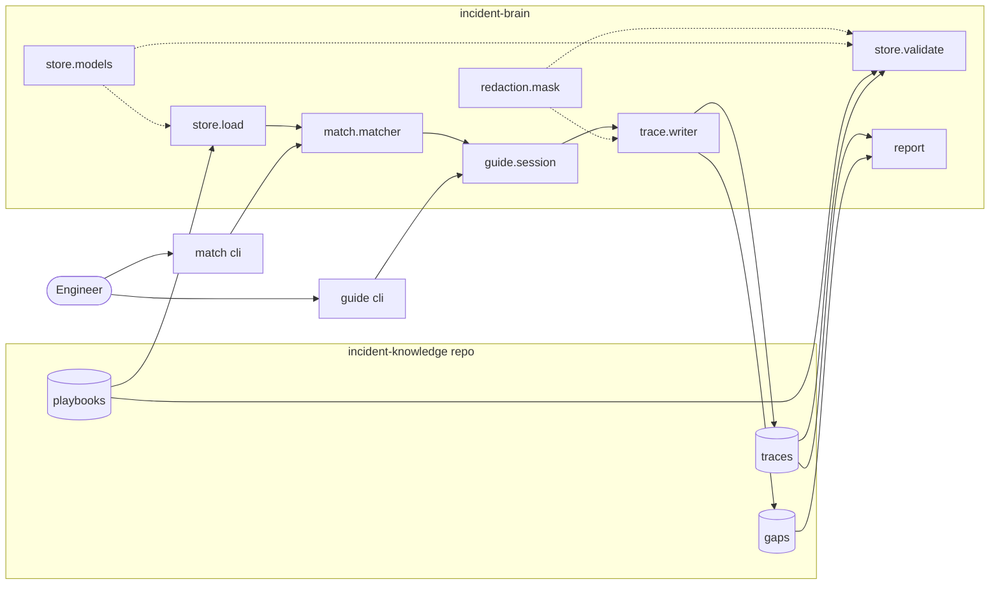

# Incident-brain
The main intention of the project was to build a worklow where a incident resolution steps and key knowledge which comes with experiance can be transferred progressevely and also with an easy of sharing those knowledge with new team member or an non technical agents for intiall troubleshooting.

## Why this tool / workflows?
If any new member takes up the support of an system without KT or limitem of amount of KT we will run into a sutitaion where he/ she may be not cable of supporting the system or too reliant on the other team members for even the intial analysis of the issue.

This tool is to bridge that gap where a non-technical person can perform basic intial trouble shooting so that he can have get a better help and also have self learning system which captures these trouble shooting for feature incident resolution.

## Arcitecture 

In the above arcitecture pre-requirement is we need atleast some basic troubleshooting playbooks which is tested and verified. 

We will be using a already avaialbe playbooks and store it in an github reposisitory, at the application runtime these playbooks will be fetched and made available in memory for the application to use.
Application will do a semantic search and ranks the playbooks as the description provided by the user, it usually prompts the use to go through the series of steps avaialable in the playbook for user to test it out so that we can isolate the problem and record the trouble shooting steps.

If the user as solved this incident in an different step, we will record the step how the user as solved the problem and create a PR for the technical team to review and make it avaialble for the application in future.

### Why not use RAG, with avaialbe playbook and knowledge articles?
We are not using RAG here because the no of playbooks available and the knowledge articles available for that application is very less. By using RAG and LLM to provide the response we will run into a issue where if two or more play books have similar keywords or an similar kind of step, the LLM may not suggest user to perform the previous related steps for more isolation of the problem and also we will not be able to record what worked and what didn't work for tracing and feature playbook creation.

In Playbooks we have different types of trust tiers as below
1. draft - New unrevieiwed
2. provisional - One confirmed fix or one reviewwed entry
3. verified - Owner sighn-off or 2+ configred fixes
4. depricated - which is not currently in scope with the application troubleshooting.

