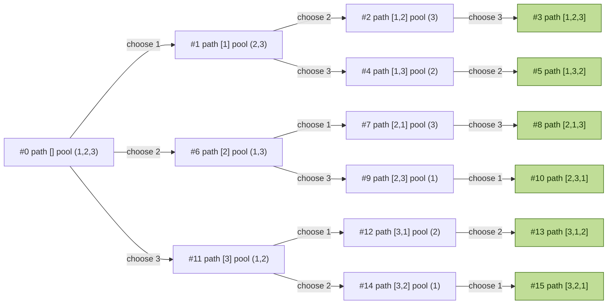

## Python and Java implementation

```java
class Solution {
    public List<List<Integer>> permute(int[] nums) {
        List<List<Integer>> res = new ArrayList<>();
        List<Integer> path = new ArrayList<>();
        boolean[] used = new boolean[nums.length];
        dfs(res, path, used, nums); 
        return res;
    }

    private void dfs(List<List<Integer>> res, List<Integer> path, boolean[] used, int[] nums) {
        if (nums.length == path.size()) {
            res.add(new ArrayList(path));
            return;
        }

        for (int i = 0; i < nums.length; i++) {
            if (used[i]) {
                continue;
            }
            used[i] = true;
            path.add(nums[i]);

            dfs(res, path, used, nums);
            path.remove(path.size() - 1);
            used[i] = false;

        }
    }
}
```

```python
class Solution:
    def permute(self, nums: list[int]) -> list[list[int]]:
        res = []
        path = []
        used = [False] * len(nums)

        def dfs():
            if len(path) == len(nums):
                res.append(path[:])
                return

            for i, x  in enumerate(nums):
                if used[i]:
                    continue

                used[i] = True
                path.append(x)

                dfs()
                path.pop()
                used[i] = False

        dfs()

        return res
```

tracing one example nums = [1, 2, 3]



